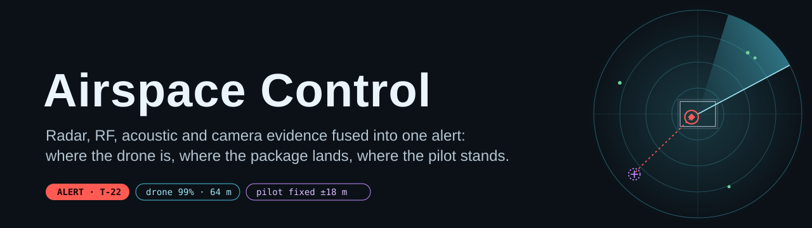
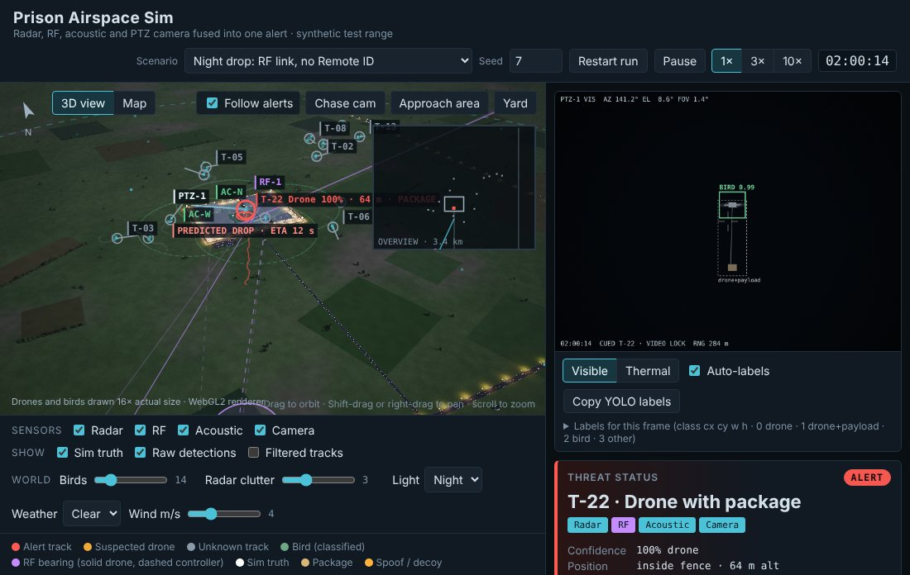
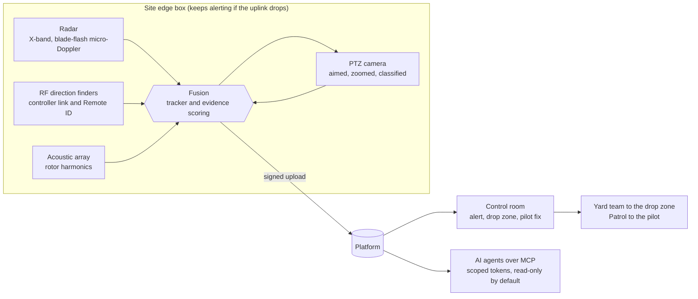
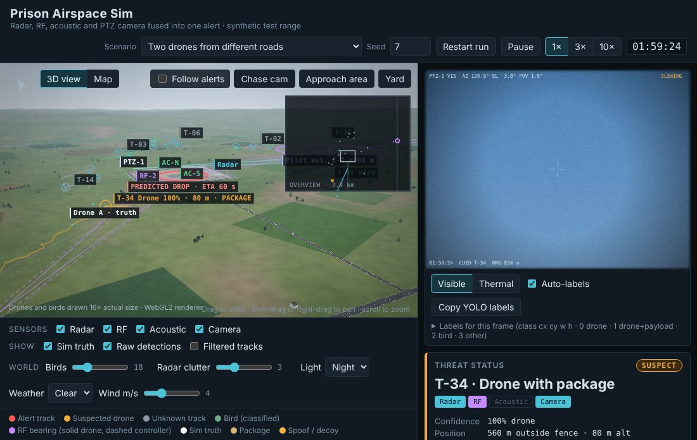
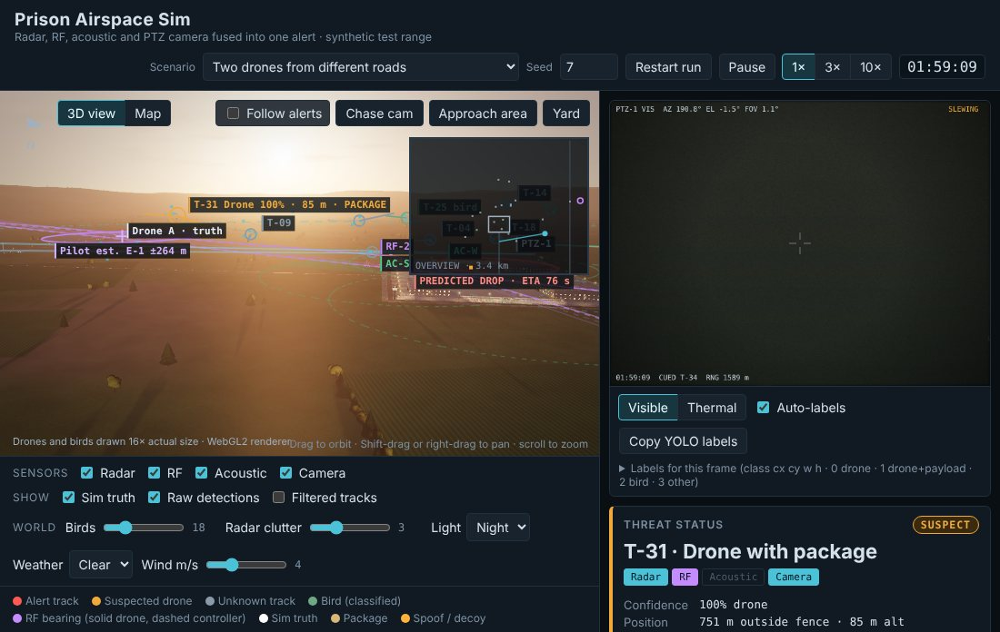
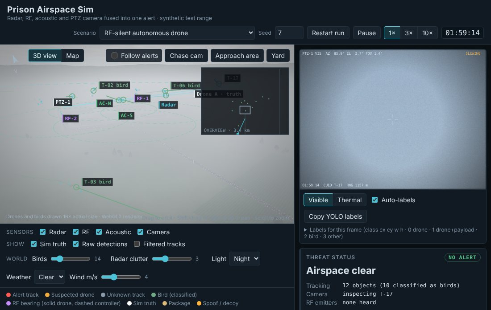
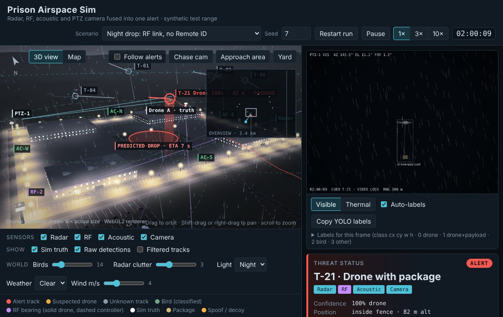
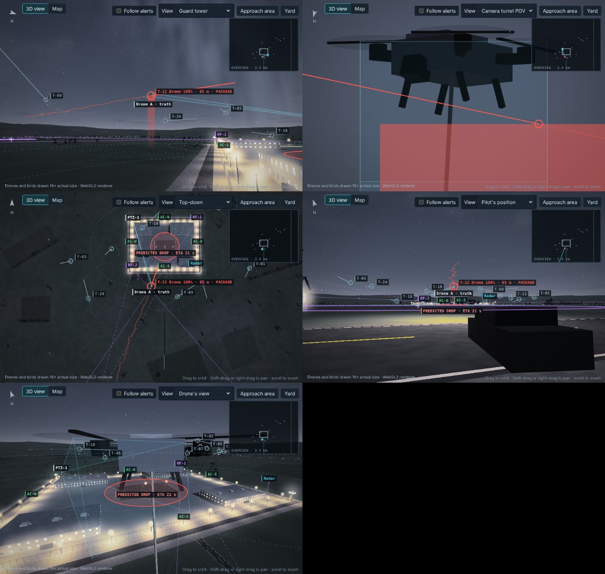
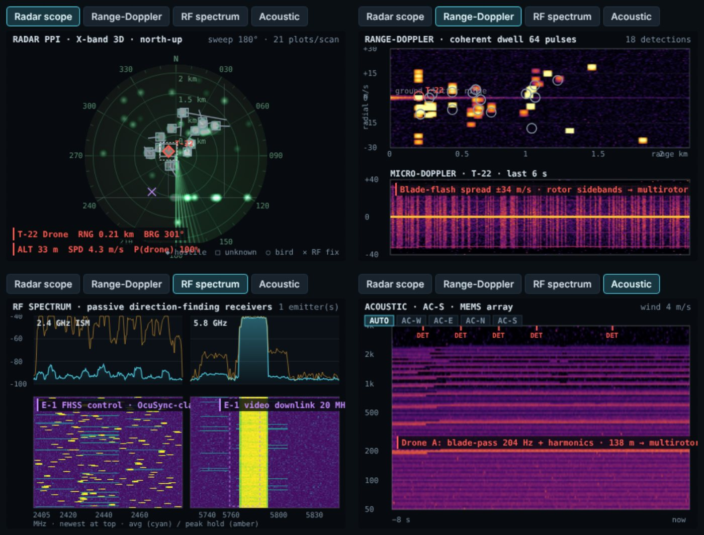
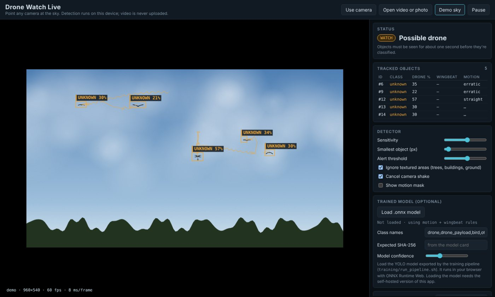

<p align="center">
  
</p>

At 2 a.m., a drone the size of a pizza box takes off from a road a mile outside a state prison. Four minutes later a package of phones and fentanyl lands in the yard. In 2024, U.S. federal prisons logged 479 drone incidents. Today the defense is a guard who happens to look up.

Airspace Control gives the control room one alert within seconds of takeoff, built from four sensors that are unreliable on their own:

- **Where the drone is,** tracked by radar and confirmed by a camera that aims itself.
- **Where the package will land,** predicted from the flight path and pinned once the drone hovers.
- **Where the pilot is standing,** triangulated from the controller's radio signal.

Guards go to the drop zone; police go to the pilot.

<p align="center">
  
</p>

## Contents

| Component | What it does | Built with |
|---|---|---|
| [Prison Airspace Sim](apps/simulator) | A 3D model of one site. Radar, RF, acoustic and camera sensors are simulated from published specs, fused into tracks, and attacked with red-team scenarios. | WebGL2 (hand-written), Canvas 2D, plain JavaScript |
| [Drone Watch Live](apps/drone-watch-live) | Point a phone, webcam or CCTV feed at the sky. It tracks objects, separates drones from birds by wingbeat, and exports labels for training. | JavaScript, ONNX Runtime Web |
| [Platform](platform) | Multi-tenant backend for operators, on-site sensor boxes and AI agents (over MCP). Independently pen-tested. | Starlette, Ed25519, SQLite (Postgres with row-level security in production) |
| [sim-core](sim-core) | Python simulator, synthetic training data, Monte Carlo evaluation, red-team suite, cloud GPU training pipeline. | NumPy, OpenCV, Ultralytics on GPU |
| [browser-model](ml/browser-model) | A 49 KB classifier trained on the simulator's own camera frames, running inside the sim page. | scikit-learn, int8 export to JS |

## How a detection becomes an alert



Each sensor fails differently:

- **Radar** tracks birds as readily as drones.
- **RF** hears nothing from a drone flying with its radio off.
- **Microphones** only reach a few hundred meters.
- **A camera** is only useful once something tells it where to point.

The fusion engine adds up evidence from all four, keeps the camera on whichever track is most suspicious, and raises an alert only when the combined evidence is strong.

## Screenshots

<table>
  <tr>
    <td width="50%"><br><sub><b>Day.</b> Fields and roads, the predicted drop zone, and the pilot fix from RF triangulation.</sub></td>
    <td width="50%"><br><sub><b>Dusk.</b> Sky color and exposure follow the time of day.</sub></td>
  </tr>
  <tr>
    <td><br><sub><b>Fog.</b> Changes what the sensors see as well as the picture: thermal reaches about 4 times farther than visible light.</sub></td>
    <td><br><sub><b>Rain.</b> Adds radar clutter and acoustic noise; wet roads reflect the lamps.</sub></td>
  </tr>
</table>

<p align="center">
  <br>
  <sub><b>Viewpoints.</b> Guard tower, camera turret at true zoom, top-down, the pilot's position, and the drone's own view.</sub>
</p>

<p align="center">
  <br>
  <sub><b>Operator displays.</b> Radar scope with sweep; range-Doppler map with a micro-Doppler strip that separates rotor flash from wingbeat; 2.4 and 5.8 GHz RF waterfalls; acoustic spectrogram of rotor harmonics.</sub>
</p>

<p align="center">
  <br>
  <sub><b>Drone Watch Live.</b> Birds are labeled by wingbeat frequency; the drone's rigid outline and hovering mark it as a drone.</sub>
</p>

## Results

> [!IMPORTANT]
> All numbers below come from simulation. The sensor models are anchored to published specs and field tests ([sources](docs/research/SENSOR_MODELS.md)), but only trials with real hardware can confirm them.

**Interactive sim:** 9 scenarios, 6 random seeds each.

| Measure | Result |
|---|---|
| Drones alerted | 54 of 54 |
| False alarms, including a 45-bird test with 4 hovering kestrels | 0 |
| Pilot location error, median and worst (with a third RF mast 1 km out) | 18 m, 40 m |
| Spoofed Remote ID broadcasts caught | 6 of 6 |
| RF decoys correctly marked "no drone seen" | 6 of 6 |

**Python red-team suite:** 18 attacks, 20 seeds each. [Full report](docs/security/REDTEAM.md)

| Measure | Before hardening | After |
|---|---|---|
| Attack scenarios with at least 95% alerted before the drop | 1 of 17 | 15 of 17 |
| False alerts across 360 attack runs | about 558 | 5 |
| Drones flying bird-like paths, alerted | 0% | 85% |

**Calibration anchors:**

| Sensor | Model anchor |
|---|---|
| Radar | A Phantom-sized drone is detected 90% of the time at 2.6 km. |
| Micro-Doppler | Rotor blade flash at about 140 Hz. |
| Thermal | Reproduces a 51 m U.S. defense field-test detection with a small thermal camera. |
| Acoustic | The array hears a drone at about 430 m in still air, and 150 m in an 8 m/s wind. |

**Still weak:**

| Weakness | What would fix it |
|---|---|
| Drones hidden in a building's radar shadow | A second radar or a fixed panel radar. |
| Cloned controllers | No fix yet. |
| Laser dazzle and camouflage against the camera | Retest against the GPU-trained model. |

## Security

The platform follows a [threat model](docs/security/THREAT_MODEL.md) and an [architecture document](docs/ARCHITECTURE.md) that maps every threat to a control. It was then attacked by a separate tester working only from the source code.

- **Queries:** every database query takes bound parameters. A static check fails the build on any query assembled from strings.
- **Tenant isolation:** each request's tenant comes from its verified login, never from the request body. Foreign keys and Postgres row-level security enforce the same boundary in the database.
- **Logins:**
  - Passwords are hashed with scrypt and a server-side pepper.
  - Supervisors and operators need two-factor codes.
  - Access tokens are signed with Ed25519 and expire after 10 minutes.
  - Refresh tokens rotate, and reusing one revokes the whole session.
- **Two-person rule:** turning off a sensor, changing an alert threshold or exporting evidence needs a second supervisor's approval.
- **Sensor boxes:** sign every upload, including the full URL, and repeated requests are rejected.
- **Evidence and records:** evidence is signed and encrypted at rest. The audit log is append-only and chained by hashes, so edits are detectable. Data is deleted after 180 days unless under legal hold.
- **AI access (MCP):** tokens are scoped to one tenant and a list of tools, expire, and are read-only by default. Text from the field is fenced off so an agent treats it as data, not instructions.

| Pen test finding | Status |
|---|---|
| F1. Text in a Remote ID broadcast could escape the MCP data fence | Fixed, retested |
| F2. A forged `X-Forwarded-For` header could spoof the audit IP and dodge login rate limits | Fixed, retested |
| F3. The query string was outside the sensor-box signature | Fixed, retested |
| 76 other attacks (SQL injection, token forgery, cross-tenant access, replays, races) | Held |

[Full report](docs/security/PENTEST_REPORT.md) · [Launch checklist](docs/security/LAUNCH_CHECKLIST.md) · Re-run the attacks with `platform/pentest/run_all.sh`

[](https://github.com/cam123-cpu/Airspace-Control/actions/workflows/ci.yml) [](https://github.com/cam123-cpu/Airspace-Control/actions/workflows/security.yml)

> [!WARNING]
> Passing these tests shows resistance to known attacks, not a certification. A real deployment also needs:
> - a gateway that authenticates each sensor box by certificate
> - keys held in a key-management service
> - a web application firewall
> - write-once evidence storage
> - an outside penetration test and a CJIS review
>
> See [SECURITY.md](SECURITY.md).

## Run it

<details open>
<summary><b>Simulator</b></summary>

```bash
cd apps/simulator && python3 -m http.server 8000
# Open http://localhost:8000. Try the red-team scenarios, the Light and Weather menus, and View.
```
</details>

<details>
<summary><b>Drone Watch Live on a phone</b></summary>

```bash
cd apps/drone-watch-live
./fetch_vendor.sh               # copies ONNX Runtime Web locally; npm verifies its integrity
python3 -m http.server 8000     # a laptop webcam works on localhost
```
Phone cameras need HTTPS. The [Pages workflow](.github/workflows/pages.yml) publishes both apps, or copy the folder to any HTTPS static host.
</details>

<details>
<summary><b>Platform</b></summary>

```bash
cd platform
pip install -r requirements-dev.txt && python -m pytest -q
export AIRSPACE_DB_PATH=dev.db
python -m airspace.cli bootstrap --tenant "Demo DOC" --email admin@demo.example
uvicorn airspace.asgi:app --port 8080 --no-server-header --no-proxy-headers --no-access-log
bash pentest/run_all.sh
```
</details>

<details>
<summary><b>Training data, evaluation and red team</b></summary>

```bash
cd sim-core && pip install -r requirements.txt
python generate_dataset.py --n 2000 --out data/      # labeled night and thermal frames, YOLO and COCO formats
python evaluate.py --nights 100 --out results/       # detection rate, false alarms, pilot error
python -m redteam.run_redteam                        # attack scenarios, before and after hardening
```
</details>

<details>
<summary><b>Training the detector on a cloud GPU</b></summary>

```bash
cd sim-core
docker build -f training/Dockerfile -t airspace-train .
docker run --gpus all --shm-size=16g -v /data:/data -e COMMERCIAL_ONLY=1 airspace-train training/run_pipeline.sh
```
The pipeline:
- downloads datasets from the [license-tagged catalog](sim-core/training/datasets.yaml)
- mixes them with synthetic frames and trains YOLO
- scores the model only on real footage
- exports a signed ONNX file that Drone Watch Live can load

[TRAINING.md](docs/research/TRAINING.md) covers each dataset's license.
</details>

## Layout

```text
apps/simulator/          3D site, sensor physics, operator displays, red-team scenarios
apps/drone-watch-live/   camera app: detect, track, classify by wingbeat, alert, label, export
platform/                API, signed device uploads, MCP server, tests, pen-test suite, deployment files
sim-core/                Python simulator, synthetic data, evaluation, red team, training pipeline
ml/browser-model/        in-page classifier: capture frames, train, export
docs/                    architecture, security (threat model, pen test, audit, red team), research
.github/                 CI, security scans, Pages deployment, Dependabot
```

## Next steps

- [x] Simulator with physics-based sensors and red-team scenarios
- [x] Camera app with label export
- [x] Pen-tested platform and MCP server
- [ ] Train YOLO on a cloud GPU, then field-test with Drone Watch Live at a real site
- [ ] Calibrate the thermal and RF models against the sensors actually bought
- [ ] Add a second radar or a fixed panel radar to cover building shadows
- [ ] Production infrastructure (certificate gateway, key management, firewall), then an outside pen test

## Legal and data

- **Taking drones down.** The SAFER SKIES Act, in the FY2026 defense authorization, plus a July 2026 DOJ/DHS interim rule, let trained and certified state, local and correctional agencies detect drones and, in some cases, disable them. Agency staff do the disabling. This project only detects and records evidence. Have a lawyer review any deployment.
- **Privacy.** Collecting RF signals and video falls under federal and state law. The platform keeps only what it needs and deletes data after 180 days.
- **Datasets.** Every training source is tagged with its license, and `--commercial-only` builds a model you can sell. Several of the strongest night and thermal datasets are research-only or have unclear terms.

<sub>Built with Claude. © 2026, all rights reserved; no open-source license has been chosen yet.</sub>
