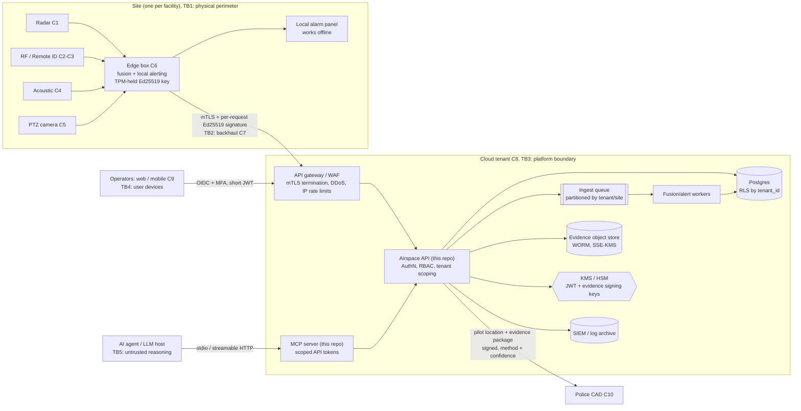

# Airspace Control: platform architecture

Multi-tenant cloud platform for counter-drone deployments. Tenants are customers such as a state corrections department or a stadium operator. Each tenant has sites; each site has one edge box fusing its sensors. Three kinds of client use the platform: operator dashboards (web and mobile), edge devices (telemetry and evidence ingest), and AI agents (through the MCP server).

This repository contains a working reference implementation of the API, data layer and MCP wrapper. Running it in production also needs the infrastructure described below (gateway, KMS, Postgres, queue, SIEM). Section 11 lists what still needs real infrastructure.

Control numbers such as "TM-7" refer to the prioritised controls in `sim-core/THREAT_MODEL.md` §7. Component numbers such as "C6" refer to its §1.

---

## 1. Components and trust boundaries

| Boundary | What crosses it | Main controls |
|---|---|---|
| TB1 site perimeter | Physical access to sensors and the edge box | Tamper switches, locked enclosures, TPM-sealed keys, read-only root FS (TM-3, TM-11) |
| TB2 backhaul | Telemetry, evidence, OTA | mTLS with a private CA; plus an application-layer Ed25519 signature on every request, a ±60 s clock window, a nonce replay cache and idempotency keys (`ingest.py`) (TM-5) |
| TB3 platform | All API traffic | Gateway WAF and mTLS. App: strict schemas, body and depth caps, CORS allowlist, security headers, generic errors (`security_headers.py`, `schemas.py`) |
| TB4 user devices | Operator sessions | MFA (TOTP now, WebAuthn next), 10-min EdDSA JWTs, rotating refresh tokens with reuse detection, per-request account re-check (TM-6) |
| TB5 AI agents | Tool calls and returned text | Scoped tokens, tool allowlist, read-only default, human confirmation code for writes, UNTRUSTED markers on free text, audited (`mcp_server.py`) |

---

## 2. Data flows

1. **Detection.**
   - Sensors feed the edge box, which fuses them and raises a local alarm at once (never waits on the cloud).
   - The edge box then sends signed telemetry to `/ingest/v1/telemetry` (202 Accepted).
   - In production that becomes queue → workers → DB. This reference writes straight to the DB.
2. **Evidence.**
   - The edge box JPEG-encodes the snapshot, hashes it and signs it with its TPM key, then sends it to `/ingest/v1/evidence`.
   - The server checks the magic bytes and re-hashes the file, then signs (id | sha256 | tenant | alert | time).
   - The file is stored under a random 256-bit key outside any web root, written once (TM-7).
3. **Operator response.**
   - The operator logs in (password + TOTP), lists alerts, acknowledges, resolves with a note, and sets a legal hold.
   - Every action is written to the per-tenant hash-chained audit log in the same transaction as the change.
4. **Sensitive changes:** disabling or enabling a sensor, changing an alert threshold or retention, and exporting evidence.
   - One supervisor requests the change.
   - A different supervisor approves it within 15 minutes.
   - Only then does it execute, atomically. Evidence export issues a one-time, 10-minute download grant to the requester (TM-6).
5. **AI agent.**
   - The MCP server authenticates with a hashed, scoped, expiring API token.
   - Tools call the same service layer, so the same tenant scoping, RBAC and parameterized SQL apply.
   - Writes (acknowledge only) also need an 8-character code that a human operator issued for that specific alert.
6. **Retention.**
   - A daily job deletes tracks, resolved alerts and evidence older than the tenant's retention period (default 180 days, matching the SAFER SKIES implementing rule's limit). Legal holds are exempt.
   - The audit log is retained separately under the CJIS policy (TM-10).

---

## 3. Tenancy model

- **Where tenant_id comes from:** always the verified principal (the user's JWT plus a DB re-check, the device record, or the API-token record). Never from a path, query string or body. Bodies carrying `tenant_id` are rejected by `extra="forbid"`.
- **Every query is scoped:** each query on a tenant-owned table has `tenant_id = ?`. Lookups by id return 404 for other tenants' objects, so their existence isn't revealed.
- **Schema-level isolation:** composite foreign keys `(tenant_id, site_id) → sites(tenant_id, id)` make cross-tenant references impossible even if application code has a bug. `test_composite_fk_blocks_cross_tenant_rows` proves it.
- **Second wall in production:** Postgres row-level security. `SET app.tenant_id` per transaction, with a policy `tenant_id = current_setting('app.tenant_id')` on every table, and the app's DB role lacking `BYPASSRLS`.
- **Platform auditor:** the one cross-tenant role. It is read-only and limited to the audit log and chain verification.

---

## 4. Identity, authentication, authorization

| Concern | Implementation |
|---|---|
| Passwords | scrypt (N=2^15, r=8, p=1), 16-byte per-user salt, HMAC-SHA256 pepper held outside the DB (KMS secret). 12–256 characters. Constant-time compare; dummy hash for unknown users so timing can't reveal accounts |
| MFA | RFC 6238 TOTP (verified against the RFC test vector), ±1 step, with replay blocking: a code's time step can only be used once. Required for operator and above and for auditors. Phishing-resistant WebAuthn is the next step (TM-6) |
| Lockout | 5 failures → exponential backoff lock (1 min doubling, capped at 1 h). Rate limits by IP and by account. The response is identical for a locked account and a wrong password |
| Access tokens | EdDSA (Ed25519) JWT, 10 min. Algorithm pinned, `kid` key ring for rotation; iss, aud, exp, nbf, iat, sub and jti required. `alg=none`, HS256 key confusion and foreign keys are all tested. The user row is re-checked on every request, so disabling a user or changing a role takes effect at once |
| Refresh tokens | Opaque, 256-bit, stored only as SHA-256, rotated on every use. Reusing a consumed token revokes its whole family (theft detection) and is audited |
| RBAC | Deny-by-default policy table (`rbac.py`). Roles: viewer, operator, supervisor, tenant_admin and platform_auditor. The full role-by-endpoint matrix is tested |
| Two-person rule | `approvals.py`: requester ≠ approver, same tenant, 15-min TTL, single execution, every step audited |
| Devices | Ed25519 key per edge box, registered per site. Production: key generated and sealed in the TPM, SPIFFE ID `spiffe://airspace/tenant/<t>/site/<s>/device/<d>` presented over mTLS at the gateway |
| Machine and agent access | API tokens bound to a tenant, a role (viewer or operator only), an explicit tool allowlist and an expiry (max 90 days). Stored as hashes, revocable instantly |

---

## 5. Secrets and key management

- **Where secrets live:** only in env vars or mounted files (`*_FILE`). In production, KMS-backed secret stores. Nothing secret is in the image or repo, and production refuses to start without them (`config.py`).
- **JWT signing:** Ed25519 key ring `AIRSPACE_JWT_KEYS="kidN:<pem>,kidN-1:<pem>"`. New tokens are signed with the first key and verified with any key in the ring. Rotation steps are in `ops/RUNBOOK_KEY_ROTATION.md`. Target: signing in KMS/HSM (asymmetric sign API), so private keys never enter app memory.
- **Evidence signing key:** a separate key with a separate rotation, the public key published for courts. Edge devices also sign with TPM keys, so the evidence carries two signatures.
- **Pepper:** a 32-byte KMS secret. It can be rotated by re-hashing on next successful login.
- **Data at rest:** Postgres TDE and object storage SSE-KMS (AES-256). In transit: TLS 1.2+ (TLS 1.3 preferred), with mTLS for devices (TM-5, CJIS v6.1).

---

## 6. Data classification and privacy

| Class | Examples | Handling |
|---|---|---|
| Restricted | Sensor coverage maps, blind spots, thresholds, device keys, evidence | Need-to-know, no bulk export, two-person export, access reviewed monthly (TM-8) |
| Confidential (CJI) | Alerts, tracks, pilot locations, operator notes | Tenant-isolated, encrypted, retained 180 days by default, legal hold |
| Untrusted input | Remote ID strings, alert titles, notes | Stored verbatim; always returned as JSON; marked UNTRUSTED for AI agents; HTML-escaped by every UI |
| Internal | Audit log, metrics | Append-only, hash-chained, streamed to SIEM/WORM |

Minimisation: RF collection keeps drone-protocol metadata only, discarded at the sensor (no content, no phones). Cameras mask public roads in software. Exports are pseudonymised unless a case number is attached.

---

## 7. Scaling and availability

- **Ingest:**
  - The gateway feeds a durable queue (e.g. Kafka or Kinesis), partitioned by `tenant_id/site_id`, so one site's flood can't starve another.
  - Idempotency keys make retries safe, and workers are stateless.
  - Per-device token buckets live in Redis, with the same interface as `ratelimit.py`.
- **Database:**
  - Postgres with synchronous standby plus read replicas.
  - Tracks partitioned by month and tenant (time-series), with keyset pagination everywhere (`seq` cursors, `LIMIT ≤ 100`).
  - Retention becomes partition drops instead of large deletes.
- **Regions:** active-passive across two regions in the same sovereignty boundary (e.g. GovCloud East/West).
  - Evidence store replicated, with object lock.
  - RPO ≤ 5 min, RTO ≤ 1 h.
- **Availability target:** 99.95% for the cloud API.
  - **Detection never depends on the cloud.** The edge box keeps detecting, alerting locally and buffering for 72 h when the backhaul or cloud is down, then replays with idempotency keys (TM-1).
  - The dashboard shows "site offline" from missing heartbeats within 60 s.

---

## 8. Observability and response

- **Logs:**
  - Structured JSON logs per request: request id, method, path, status, latency.
  - Never bodies, tokens, query strings or secrets. Evidence grants travel in a header, not the URL, so they don't land in proxy logs.
- **SIEM detections:**
  - refresh-token reuse
  - lockout bursts
  - a 401 storm from one device (key theft or clock drift)
  - two-person approvals at odd hours
  - export grants
  - MCP write calls
  - audit-chain verification failures (run hourly)
- **Incident response:** severity-classified runbooks.
  - Device key compromise: deactivate the device, rotate, re-enrol.
  - Signing key compromise: emergency rotation by removing the old `kid` from the ring, which invalidates outstanding tokens within 10 min.
  - Insider: freeze the account, preserve the audit chain.
  - CJIS notification timelines apply (TM-13).

---

## 9. Supply chain

- Pinned dependencies (`requirements.txt`). Production adds hash-pinned `--require-hashes` locks, reproducible builds and a signed SBOM (CycloneDX) for every release (TM-9).
- Container: minimal base, non-root, read-only root FS, no shell in the final image (`ops/Dockerfile`).
- Models are shipped as ONNX (no pickle) with signatures checked at load. OTA bundles are signed and protected against rollback (TM-4).
- CI gates:
  - `tests/test_sql_safety.py`: no dynamic SQL, no eval, exec or subprocess.
  - The full pytest security suite.
  - SAST (bandit, semgrep), `pip-audit`, container scan, and secret scanning. These need network access in CI.

---

## 10. Control map

| Threat-model control | Where it lives |
|---|---|
| TM-1 Fail-loud health | `sensors` status via ingest; offline detection from `last_seen`. Edge-local alerting is outside this repo |
| TM-2 Remote ID untrusted | `remote_id_text` stored as untrusted text, marked for agents, never used for authorization. Spoof corroboration is in fusion (sim) |
| TM-3 Edge hardening | Device keys per site, deactivation, signed requests (`ingest.py`). TPM, secure boot and read-only FS are edge build items |
| TM-4 Signed OTA | Design (§9); not in this service |
| TM-5 mTLS + AES-256 | Gateway + KMS (§5); app-layer signing adds defence in depth |
| TM-6 MFA, RBAC, two-person | `auth.py`, `sessions.py`, `rbac.py`, `approvals.py` |
| TM-7 Evidence integrity | `evidence.py`: sha256, server signature, re-hash on download, one-time grants, write-once files, signature check endpoint |
| TM-8 Restricted coverage data | RBAC on sites/sensors, two-person for sensor changes, no bulk export endpoints |
| TM-9 ML supply chain | ONNX-only inference, manifests (training pipeline), SBOM (§9) |
| TM-10 Privacy / 180-day deletion | `retention.py` with legal hold; audit kept separately |
| TM-12 SIEM | Structured logs + hash-chained audit (`audit.py`) |
| TM-13 Disclosure & IR | `SECURITY.md`, §8 |

---

## 11. Known gaps needing real infrastructure

1. **Edge identity:** an mTLS gateway with a private CA and SPIFFE device identities. The app currently relies on its own request signatures.
2. **Signing keys:** KMS/HSM-held JWT and evidence keys. Today they are in process memory, loaded from env.
3. **Database:**
   - Postgres with row-level security as a second isolation wall. SQLite here.
   - The swap is mechanical (`?` → `%s`, `AUTOINCREMENT` → `GENERATED ALWAYS AS IDENTITY`).
4. **Shared rate limits:** Redis-backed limits shared across replicas. In-process here.
5. **Network edge:** WAF and DDoS protection at the edge.
6. **Durable ingest queue** and workers.
7. **Evidence storage:** WORM object storage with object lock. Local files here.
8. **Phishing-resistant MFA:** WebAuthn/FIDO2. TOTP here.
9. **External penetration test** by an accredited third party, plus a CJIS security audit. The in-repo suite is a regression floor, not a substitute.
10. **Security tooling:** SAST (bandit, semgrep), dependency audit (pip-audit) and container scanning in CI. They couldn't be installed in this build environment.
